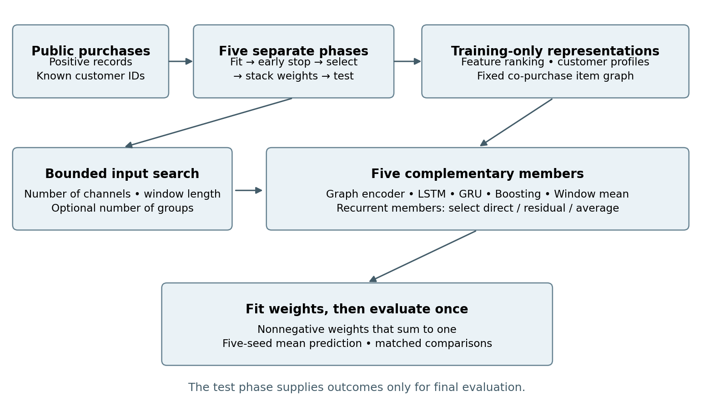

# GTS: clean peer-review revision

Code and evidence for **GTS: Evaluating graph-temporal ensembles and selected inputs for next-purchase timing**.

Authors: A. Rezaei, S. A. Khalilpour, H. Kh. Seyedi and H. D. Taghirad. Applied Robotics and AI Solutions (ARAS), K. N. Toosi University of Technology, Tehran, Iran. Correspondence: taghirad@kntu.ac.ir.



## Current study

Start in [`revision_v2`](revision_v2/README.md). This unified clean PyTorch implementation is the only evidence used by the current article. All three datasets have five seeds, separate train/early-stop/selection/stack/test phases, full causal sliding training origins, structural controls, single-seed graph/loss diagnostics, matched five-horizon comparisons, customer-level inference and live model reconstruction checks.

Results do not establish universal GTS superiority. Boosting leads Online Retail II primary MAE; fixed GTS leads Ta-Feng; the DeepAR adaptation leads Instacart MAE/RMSE. Selected GTS MAEs are 11.3349, 2.1199 and 6.4980 on 627, 1808 and 204118 complete outcomes. Instacart uses recorded relative same-item days, not actual dates. The five-horizon task contains 69 common origins.

## Verify the public package

Install the numerical requirements, then run:

```sh
python revision_v2/verify_published_results.py
```

This checks public hashes and aggregate consistency. It does not claim to recompute point errors without local predictions. Full reproduction uses locally acquired raw data, prepared arrays and model weights, followed by `revision_v2/verify_results.py`. The new revision publishes aggregate metrics, counts, search traces and feature rankings; raw records, per-origin identifiers and weights are excluded.

## Obtain inputs

Use [Online Retail II at UCI](https://archive.ics.uci.edu/dataset/502/online+retail+ii), the [public Ta-Feng mirror](https://www.kaggle.com/datasets/chiranjivdas09/ta-feng-grocery-dataset), and [Instacart competition data](https://www.kaggle.com/competitions/instacart-market-basket-analysis/data). Follow provider terms. Public availability is not an unrestricted redistribution license.

Expected files under your chosen data root:

- `online_retail_ii/online_retail_II.parquet`: concatenate both official workbook sheets without filtering. `revision_v2/prepare_public_formats.py` converts the workbook; `.xls` requires `xlrd`.
- `ta_feng/ta_feng_all_months_merged.csv`: merged four-month public file with `TRANSACTION_DT`, `CUSTOMER_ID`, `PRODUCT_ID`, `AMOUNT`, `SALES_PRICE`.
- `instacart/orders.csv`, `instacart/order_products__prior.csv`, `instacart/order_products__train.csv`.

Different serialization can change byte hashes; preserve provenance and compare cohort counts and preparation audits. Do not silently reduce the data. Preparation drops missing IDs before conversion, removes nonpositive purchases and shares daily calendar cuts or original-customer Instacart order cuts.

## Reproduce

Install an appropriate PyTorch 2.2.2 build and `revision_v2/requirements.txt`. Executed environment: Python 3.12, PyTorch 2.2.2+cu121, NumPy 1.26.4, pandas 2.2.2, SciPy 1.13.1, scikit-learn 1.4.2. Set `GTS_CACHE_ROOT` to a large temporary drive for exact full-cohort boosting. CPU operation is supported but can be slow.

Follow the commands in `revision_v2/README.md`: preparation, causal audit, regression tests, main fitting, aggregation, controls, horizons, diagnostic statistics, benchmarking, plots, independent verification. A full local gate exists only after all stages succeed. `build_paper_evidence.py` uses that complete local tree to build article tables and diagrams. The public aggregate check is a deliberately separate verifier.

`results/metrics.csv` scores five-seed mean predictions; `seed_metrics.csv` scores individual runs. Ablation scope distinguishes full-system and standalone encoder. Paired inference includes MAE/RMSE/MedAE intervals and Holm-adjusted MAE/MSE tests. Every horizon is separate. Costs distinguish search, member fits, stacking and prepared-history batch inference; batch cost is not service latency.

`cohorts/` contains counts, feature names and training ranking/removal records. `input_search/` retains every tested configuration and selected design. The editable [workflow](figures/revision_overview.drawio) is importable into Lucidchart; no native Lucidchart document is claimed.

## Historical material

Root-level earlier scripts, `legacy/`, old `data/` and figures without the `revision_` prefix are historical provenance. They are not evidence for the current article. Old missing-ID artifacts, terminal splits and 103855-pair scores are not relabeled as new results. Use `revision_v2` for current reproduction.

## Earlier work and limits

[Rezaei et al., ICRoM 2024](https://doi.org/10.1109/ICRoM64545.2024.10903646) studied classification on a private source. Its records and scores are excluded here. Existing human credit and third-party notices remain.

Complete-case metrics depend on follow-up. Instacart cannot recover dates. Search is bounded; graph/attention effects are small and inconsistent. Five seeds and single-seed diagnostic grids limit uncertainty. No campaign profit, prospective deployment, optimal selector or journal-acceptance claim is made.
