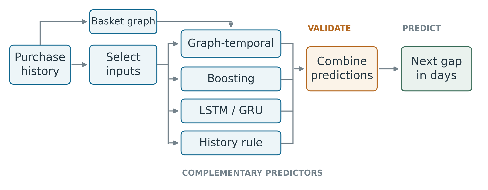

# GTS: Next-purchase timing

Research code and prediction evidence for **GTS: A graph-informed temporal ensemble for next-purchase timing on public retail data**.

Authors: A. Rezaei, S. A. Khalilpour, H. Kh. Seyedi, and H. D. Taghirad. All authors: Applied Robotics and AI Solutions (ARAS), K. N. Toosi University of Technology, Tehran, Iran. Corresponding author: H. D. Taghirad, taghirad@kntu.ac.ir.



## Start with the evidence

The repository contains real saved predictions and a numerical verifier. Raw third-party transactions and trained weight files are excluded. Install Python 3.12, NumPy, pandas, and PyArrow, then run:

```sh
python verify_results.py
```

`data/verified_results.json` describes archived fixed-input experiments. `data/adaptive_instacart_results.json` describes a **fresh matched fixed/adaptive experiment**. They have separate runtimes and must not be mixed into a claim that a changed model produced an old score.

## Reproduce the new Instacart experiment

Obtain `orders.csv`, `order_products__prior.csv`, and `order_products__train.csv` from the [original Instacart competition data](https://www.kaggle.com/competitions/instacart-market-basket-analysis/data). Put them in `data/raw/instacart/` and follow the provider's terms. The modeling target is the recorded number of days until the same item is purchased again, including intervening orders that omit it. It is not a real calendar date. The released relative-time field has an upper recorded value of 30 days.

```sh
python -m pip install -r requirements-review.txt
python prepare_instacart.py --data-root data/raw/instacart --output-root work
python prepare_adaptive_instacart.py --data-root data/raw/instacart --benchmark-root work --output work/adaptive/instacart
python run_adaptive_instacart.py --benchmark-root work --experiment-root work/adaptive/instacart
python aggregate_adaptive.py --benchmark-root work --experiment-root work/adaptive/instacart --output-root reproduced
```

For the recorded GPU experiment, PyTorch 2.2.2 with CUDA 12.1 ran on an NVIDIA RTX 3050. Install the appropriate official PyTorch build for your machine; CPU execution is supported and takes longer. Hardware and library changes can affect neural fits. The supplied environment file records the experiment environment, rather than promising bit-for-bit agreement across hardware.

Both arms use the same new PyTorch code, five seeds, an epoch cap of 30, batch size 1,024, and patience six. The fixed arm uses the historical 25 numerical inputs and a five-event context. The adaptive arm allows all 40 numerical candidates to be excluded, chooses a ranked prefix size, tests context lengths one through five, and tests no groups or two through eight groups. The input search uses only training and validation observations. Its full trace and chosen names are in `data/input_selection_report.json` and `data/input_selection_trials.csv`. Selection is economical coordinate search with a boosting probe, not exhaustive architecture discovery or a guaranteed global optimum.

The full cohort contains 103,855 customer-product histories belonging to 25,508 original customers. The final models use all 332,635 training and 103,855 validation windows, and score 103,855 test origins. The selector alone uses a fixed subsampling budget. `data/portable_preparation_verification.json` records checks of the standalone preparation against the archived arrays, keys, and graph (up to spectral-vector signs).

## Public daily experiments

The archived prediction evidence uses [Online Retail II](https://archive.ics.uci.edu/dataset/502/online+retail+ii) and the public [Ta-Feng mirror](https://www.kaggle.com/datasets/chiranjivdas09/ta-feng-grocery-dataset). Historical daily training routines are included in `legacy/`. They require a separate environment with TensorFlow, in addition to the numerical dependencies. The archived public-task record used TensorFlow 2.19.0 and Keras 3.9.2; the old daily runs do not have a complete independent environment lockfile.

Example clean daily refits:

```sh
python legacy/run_public_daily.py --dataset online-retail-ii --input data/raw/online_retail_II.parquet --output work/daily_s42 --seed 42
python legacy/run_public_daily.py --dataset ta-feng --input data/raw/ta_feng_all_months_merged.csv --output work/daily_s42 --seed 42
```

Repeat with seeds 7, 1400, 2026, and 31337 for five-run scoring. Clean refits produce **new results**. The old Online Retail II adapter pooled missing customer IDs into one series. Manuscript scores exclude its test forecast from every method, but the fitted models still contain the training artifact. The CLI now drops missing IDs before conversion by default; `--legacy-pooled-ids` exists only for explicitly reproducing the historical behavior. Do not label a clean refit as a reproduction of the archived scores.

Historical standalone-encoder ablations in the source are not used as causal evidence of graph or attention effects. A full-system matched ablation is still needed. The 411-customer Transformer comparison is available as prediction evidence; the original architecture source is [Grigoraș's released code](https://github.com/alexgrigoras/next_purchase_day), commit `0740e0380a2ca10b9b616b7c8d431842677d3ee1`. This repository does not redistribute that external project.

## Interpretation limits

These are retrospective terminal-history splits. Another customer's or product pair's training record can be later than a particular forecast origin. The graph has an additional customer-order cutoff, but this does not make all pooled training prospectively available. Research development also included examination of earlier test results. Independent shared-cutoff evaluation and the clean identifier refit remain necessary for stronger confirmation. No measured marketing profit, deployed reliability, universal best-model claim, or exact reproduction of an external paper's original scores is asserted.

## Files

| File | Purpose |
|---|---|
| `adaptive_inputs.py` | Optional feature count, context, and grouping selection |
| `prepare_instacart.py` | Public raw CSVs to matched histories, targets, graph, and fixed inputs |
| `prepare_adaptive_instacart.py` | Complete optional candidate bank on identical origins |
| `run_adaptive_instacart.py` | Five-member fixed/adaptive temporal ensembles |
| `stacking.py` | Grouped validation selection and refitting of the combiner |
| `aggregate_adaptive.py` | Ensemble scoring, original-customer bootstrap, and figures |
| `verify_results.py` | Self-contained checks of saved prediction evidence |
| `data/` | Prediction records, metrics, selection trace, and preparation checks |
| `figures/` | Original diagrams and result figures in editable vector formats |
| `legacy/` | Archived fixed-input daily implementation and public-data CLI |

## Earlier work

A. Rezaei, A. Jahani, D. A. Nejad, A. Mehrabi, S. A. Khalilpour, H. Kh. Seyedi, and H. D. Taghirad, “Predicting Customer Behavior in Autonomous Retail Application: A Classification-Based Approach,” ICRoM 2024, pp. 529–536. [DOI: 10.1109/ICRoM64545.2024.10903646](https://doi.org/10.1109/ICRoM64545.2024.10903646).

That work used classification and a proprietary source. Its private records and fitted results are not included here. The present experiments use only the three public sources listed above. Provider terms continue to govern dataset use. No general redistribution license for third-party datasets is implied.
